

  Tamanho do texto:
  <button onclick="diminuirFonte()" title="Diminuir texto" style="padding: 6px 12px; font-weight: bold; cursor: pointer; border: 1px solid #ccc; border-radius: 4px; background: #f8f9fa;">A-</button>
  <button onclick="resetarFonte()" title="Tamanho normal" style="padding: 6px 12px; font-weight: bold; cursor: pointer; border: 1px solid #ccc; border-radius: 4px; background: #f8f9fa;">A</button>
  <button onclick="aumentarFonte()" title="Aumentar texto" style="padding: 6px 12px; font-weight: bold; cursor: pointer; border: 1px solid #ccc; border-radius: 4px; background: #f8f9fa;">A+</button>
  
  <button onclick="window.print()" style="background-color: #0056b3; color: white; padding: 6px 16px; border: none; border-radius: 5px; font-size: 14px; cursor: pointer; box-shadow: 0 2px 4px rgba(0,0,0,0.2); margin-left: 10px;">
    🖨️ Imprimir ou baixar esta página
  </button>

PÚBLICO-ALVO: USUÁRIOS GOVERNO

# Eventos de Suspensão, Revogação e Anulação no Novo Divulgação de Compras - Manual Completo

Consulte abaixo todas as orientações referentes aos eventos de alteração e encerramento em contratações diretas, licitações presenciais e credenciamentos.

---

# 1. VISÃO GERAL E REGRAS DOS EVENTOS

Está disponível, no Novo Divulgação de Compras, a funcionalidade **“Eventos de Suspensão, Revogação e Anulação”** para contratações diretas, licitações presenciais e credenciamentos.

!!! note "Nota"
    As alterações são automaticamente refletidas no Portal Nacional de Contratações Públicas (PNCP), por isso não há a necessidade de revogar o resultado já divulgado no PNCP e publicar uma nova contratação.

!!! warning "Atenção"
    Os eventos de anulação e revogação são destinados apenas para contratações já encerradas e publicadas no PNCP.

## Procedimentos Iniciais

**Passo 1:** Acesse o Portal de Compras do Governo Federal e clique em “Acesso ao Sistema”.

**Passo 2:** Escolha o perfil “Governo” e faça o login.

**Passo 3:** Acesse o módulo “Novo Divulgação de Compras”.

---

# 2. PROCEDIMENTOS PARA REALIZAÇÃO: EVENTO DE ANULAÇÃO E REVOGAÇÃO

Eventos de anulação podem ser necessários quando houver alguma ilegalidade processual.  
Eventos de revogação podem ser feitos por necessidade ou conveniência da administração pública.

**Passo 4:** Clique na aba “Contratações Encerradas”.

**Passo 5:** Clique nos três pontos e selecione “Anular/Revogar”.

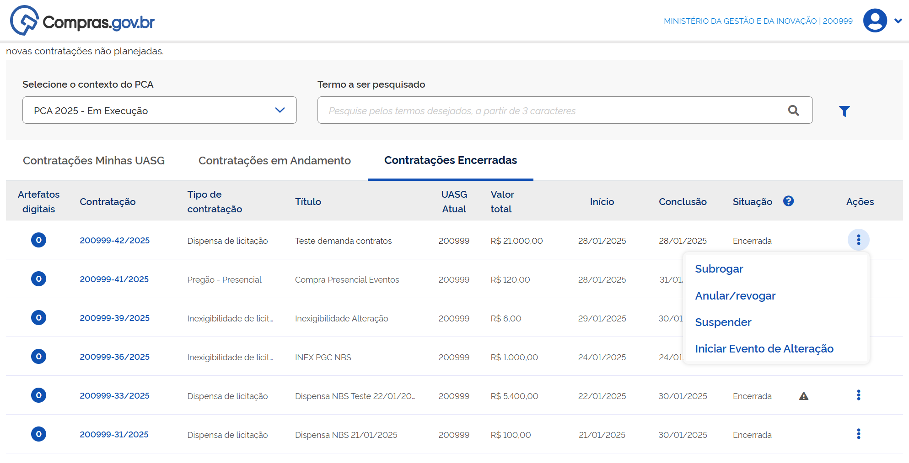

O sistema mostrará a página de resumo da contratação.

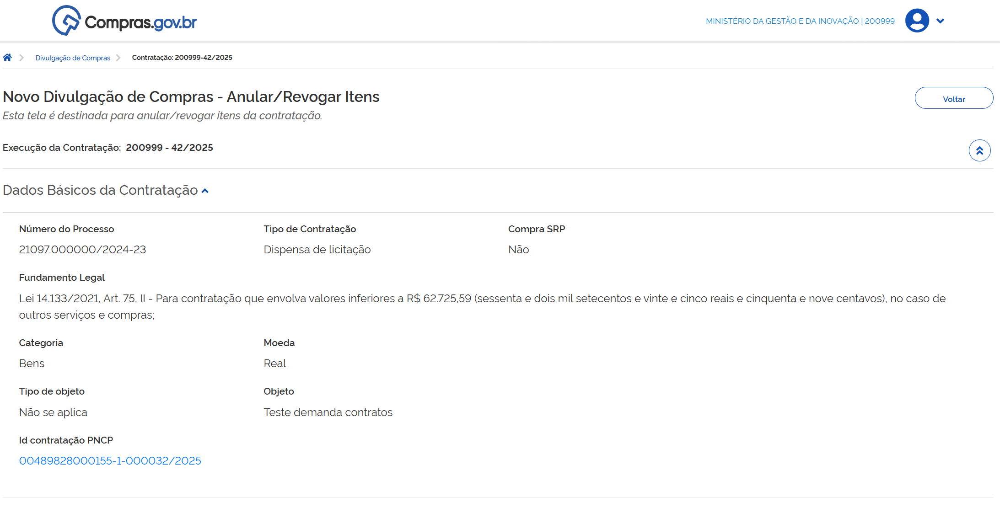

**Passo 6:** Role a tela e localize os itens que deseja alterar.

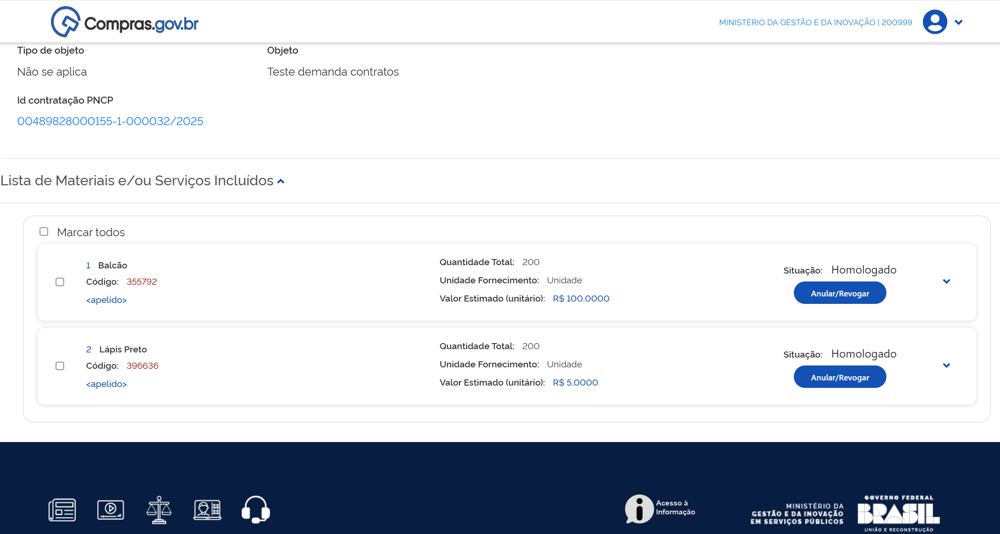

**Passo 7:** Clique no botão “Anular/Revogar”.

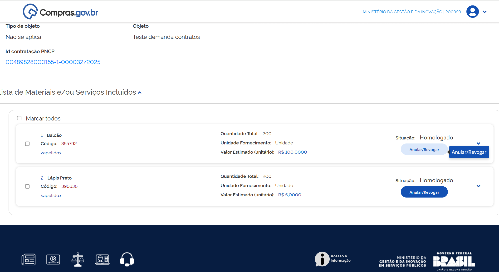

O sistema abrirá uma tela para registro do tipo de anulação/revogação para inclusão da justificativa da ação.

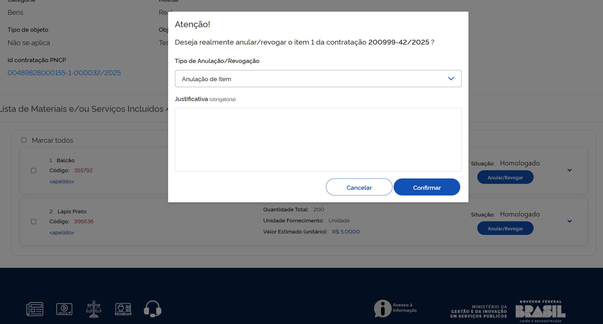

**Passo 8:** Selecione a ação a ser realizada, escreva a justificativa e confirme.

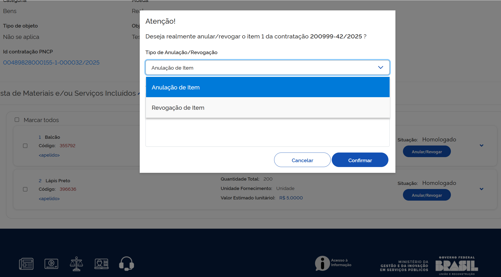

O sistema confirmará a finalização com sucesso.

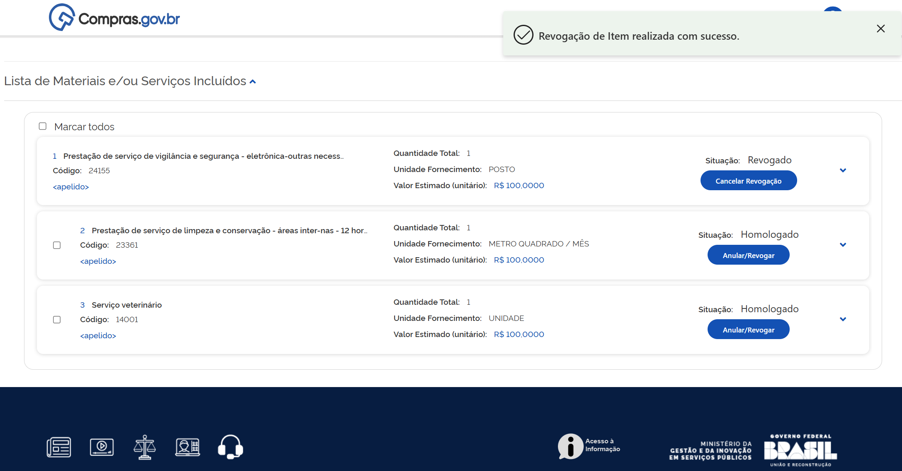

!!! warning "Atenção"
    Caso haja qualquer impedimento no sistema Contratos (empenho ou contrato ativo relacionado ao item), o sistema emitirá alerta da existência deste impedimento e não registrará a ação.

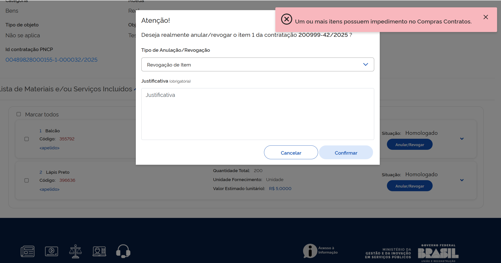

## Cancelamento do Evento de Anulação ou Revogação

!!! note "Nota"
    É possível cancelar o evento de anulação ou revogação.

Para cancelar a anulação ou revogação de item, em *Contratações Encerradas* na página inicial do Novo Divulgação de Compras, clique nos três pontos e selecione “Anular/revogar”.

Também é possível realizar o cancelamento do evento de anulação ou revogação a partir da aba *Contratações em Andamento* da tela inicial do Novo Divulgação de Compras. No entanto, essa opção aparece somente quando todos os itens da contratação estiverem anulados e/ou revogados.

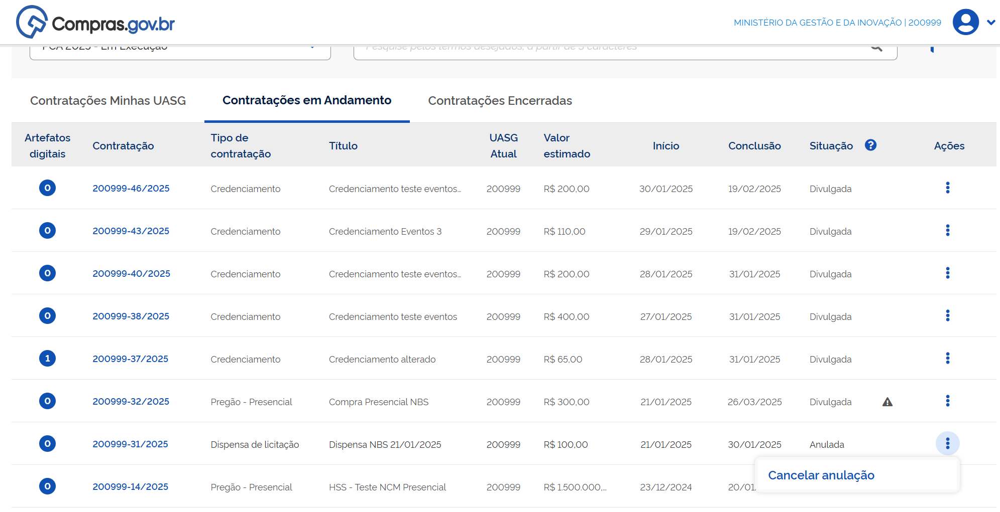

**Passo 9:** Clique nos 3 pontos e em seguida em “Cancelar anulação”.  
O sistema retornará à página de resumo da contratação.

**Passo 10:** Role a tela para baixo e localize os itens que deseja alterar.

**Passo 11:** Clique em “Cancelar Revogação”.

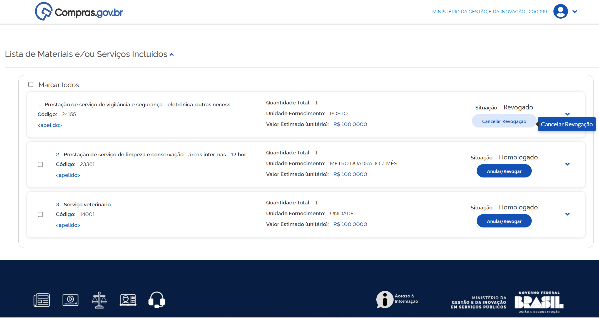

O sistema abrirá uma tela para registro da justificativa da ação.

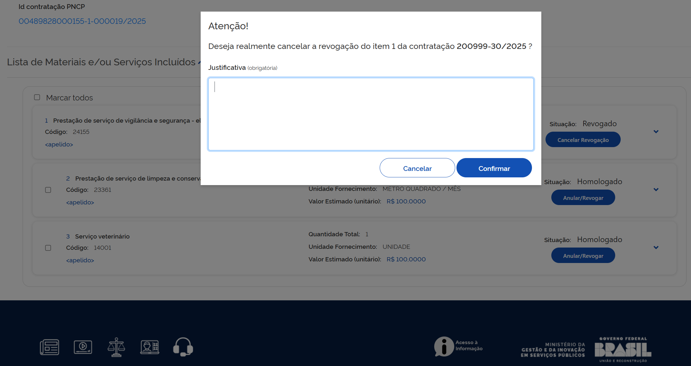

Preencha e confirme a ação. O sistema confirmará a finalização com sucesso.

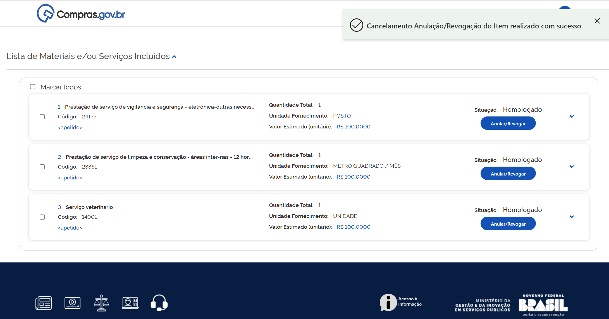

---

# 3. EVENTO DE SUSPENSÃO

!!! warning "Atenção"
    O evento de suspensão está disponível somente para licitações presenciais em andamento e contratações diretas.

**Passo 1:** Acesse o Portal de Compras do Governo Federal e clique em “Acesso ao Sistema”.

**Passo 2:** Escolha o perfil “Governo” e faça o login.

**Passo 3:** Acesse o módulo “Novo Divulgação de Compras”.

**Passo 4:** Clique na aba “Contratações em Andamento”.

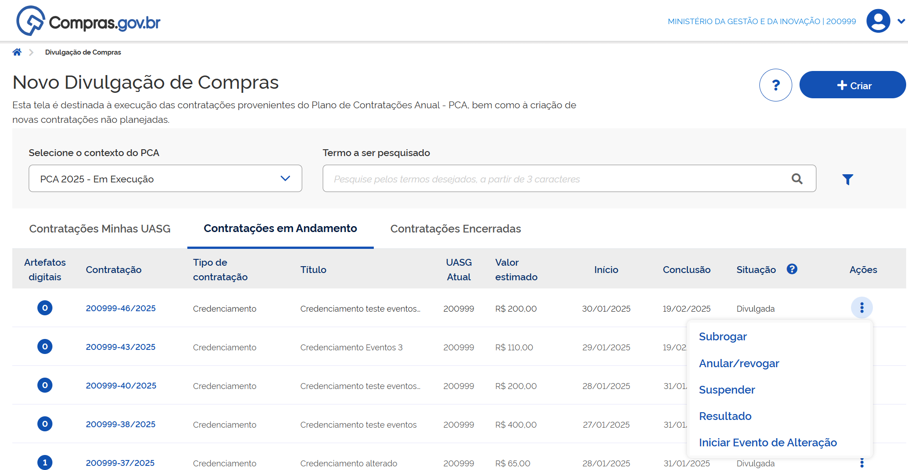

**Passo 5:** Na contratação desejada, clique nos três pontos e selecione “Suspender”.

**Passo 6:** O sistema abrirá uma tela para registro da justificativa da ação. Preencha e confirme a ação.

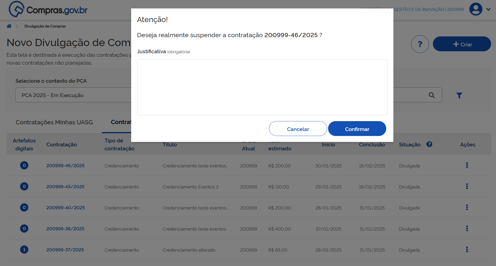

O sistema confirmará a finalização com sucesso.

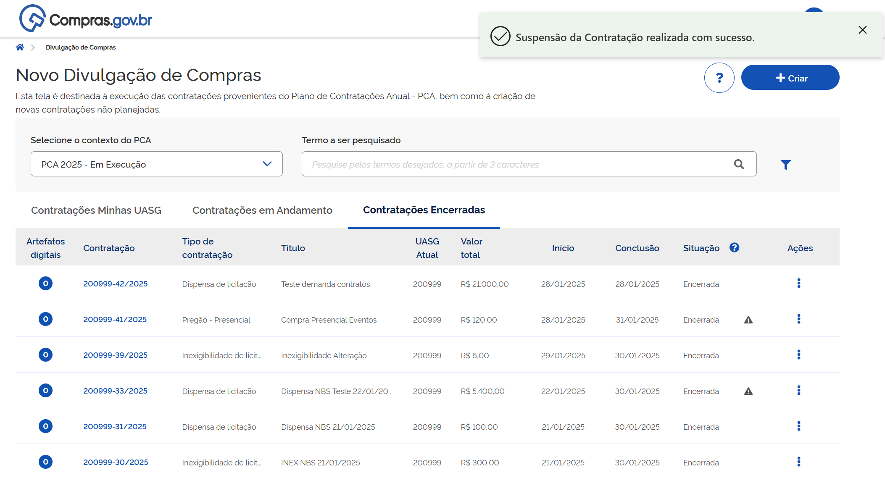

!!! warning "Atenção"
    Caso haja qualquer impedimento no sistema Contratos (empenho ou contrato ativo relacionado ao item), o sistema emitirá alerta da existência deste impedimento e não registrará a ação.

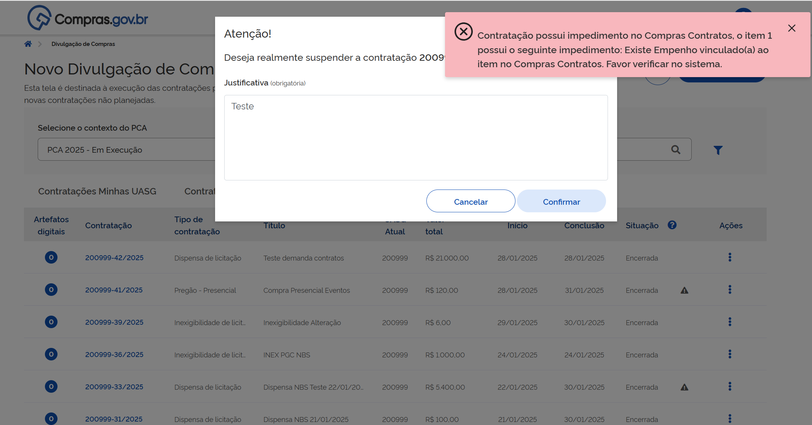

## Cancelamento do Evento de Suspensão

!!! note "Nota"
    É possível cancelar o evento de suspensão.

**Passo 7:** Para isso, na aba *Contratações em Andamento* na página inicial do Novo Divulgação de Compras, encontre a contratação desejada, clique nos 3 pontinhos e depois em “Cancelar suspensão”.

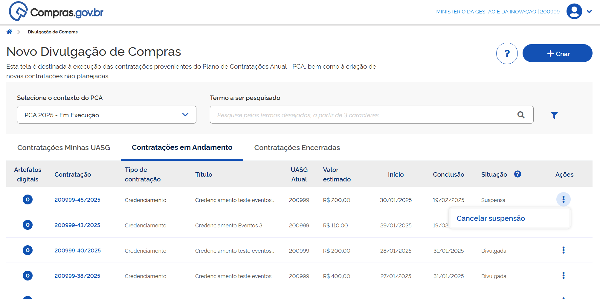

O sistema abrirá uma tela para registro da justificativa da ação. Preencha e confirme a ação.

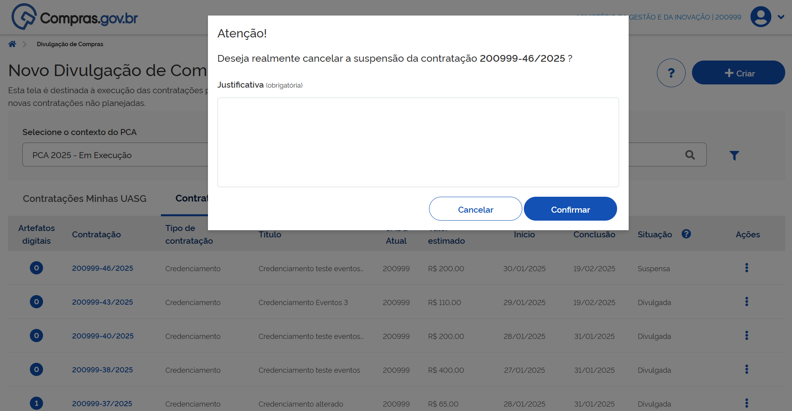

O sistema confirmará a finalização com sucesso.

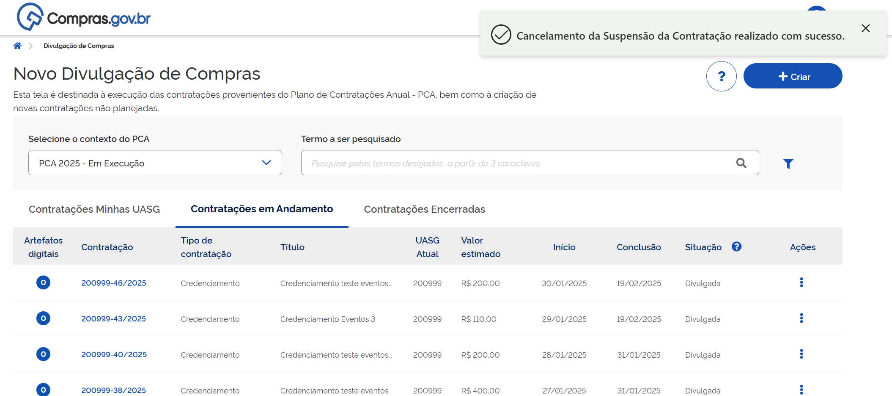

---

Em caso de dúvidas, entre em contato com a Central de atendimento clicando [aqui](https://www.gov.br/compras) ou pelo telefone **0800-978-9001**.

 

  <button onclick="window.print()" style="background-color: #0056b3; color: white; padding: 10px 20px; border: none; border-radius: 5px; font-size: 16px; cursor: pointer; box-shadow: 0 2px 4px rgba(0,0,0,0.2);">
    🖨️ Imprimir ou baixar esta página
  </button>

